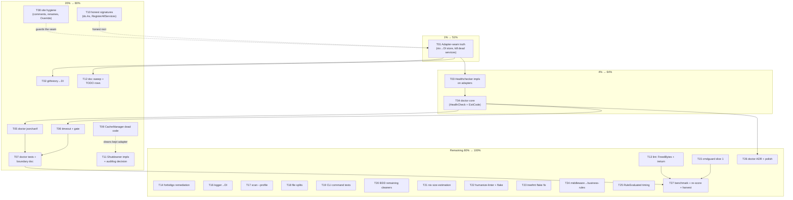

# Pareto Execution Plan — samber/do Health & Architecture Remediation

**Created:** 2026-10-31 11:50 CET
**Input universe:** 50 items from `docs/status/2026-10-31_11-38_samber-do-healthcheck-architecture-audit-session.md` (§f) + audit findings F-1…F-7 (`docs/reviews/2026-10-31_samber-do-healthcheck-architecture-audit.md`)
**Baseline scores:** Service-Oriented 6/10 · Composable 8/10 · Resilient 7/10 · Self-Health 1/10
**Result definition:** a _truthful_ DI architecture (no dead services, docs match code) with _visible self-health_ (doctor command) and the durability hygiene that keeps it true.

> **Verschlimmbesser guardrails (binding for every task below):**
>
> - No speculative refactors. Every task names the exact file/line it touches.
> - DO-5 (`cleaners.go` loop-InvokeNamed) is **by design** — comment it, never "fix" it.
> - `(nil, nil)` in `resolveProfileOperationSettings` is **domain semantics** — comment, don't change.
> - Interface-returning accessors are **correct DI style** — suppress with reason, don't un-interface.
> - cmdguard migration must preserve `errorfamily.ExitCode` at the boundary and fang rendering.
> - Every task ends with build + relevant tests green. Breaking build = task not done.

---

## 1. Pareto Breakdown

| Tier                         | Tasks (of 50)                                                                                                                                                                                                                                                            | Cumulative value | What it is                                                                                                                                                                                                                                                                                           | Why this much value                                                                                                                                                               |
| ---------------------------- | ------------------------------------------------------------------------------------------------------------------------------------------------------------------------------------------------------------------------------------------------------------------------ | ---------------- | ---------------------------------------------------------------------------------------------------------------------------------------------------------------------------------------------------------------------------------------------------------------------------------------------------- | --------------------------------------------------------------------------------------------------------------------------------------------------------------------------------- |
| **1%** → **51%**             | 1 task: **T01 Adapter-seam truth** — nix provider resolves `adapters.NixStore` from DI; consume-or-delete the 3 dead services                                                                                                                                            | ~51%             | The root-cause fix. The audit's central finding is that the architecture _lies_: documented adapter-via-DI is bypassed inline, 3 of 4 services have zero consumers. Everything else (health checks, honest docs, swappable adapters) is blocked or meaningless until the container reflects reality. | One ~90min task converts the biggest documented falsehood into truth and unblocks the entire self-health tier.                                                                    |
| **4%** → **64%**             | 2 more tasks: **T03 Healthchecker impls on adapters** + **T04 doctor command core**                                                                                                                                                                                      | ~64%             | Self-health becomes real and _visible_: adapters implement `do.HealthcheckerWithContext`, `clean-wizard doctor` runs `injector.HealthCheckWithContext` and maps failures to sysexits.                                                                                                                | Architecture truth (T01) + a user-facing health surface is the difference between "we have a DI container" and "we have a self-describing system". Self-Health goes 1/10 → ~7/10. |
| **20%** → **80%**            | 10 more tasks: **T02 githistory→DI · T05 doctor JSON/SARIF · T06 timeout+gate · T07 doctor tests+boundary doc · T08 comments/renames/Override · T09 CacheManager dead code · T10 do.As+signature honesty · T11 Shutdowner impls · T12 doc sweep · C-cluster durability** | ~80%             | The durability cluster: makes the fixed architecture _stay_ true — consistency across commands, machine-readable health, tested contracts, honest signatures, docs that match code.                                                                                                                  | Truth that regresses is worth little; this tier locks the 64% in with tests, comments-at-site, and cross-command consistency.                                                     |
| **Remaining 80%** → **100%** | ~23 tasks: **T13–T27** — lint remediation, cmdguard, logger→DI, file splits, BDD coverage, CLI tests, flake fixes, ADR, measurement                                                                                                                                      | final 20%        | Pre-existing backlog + polish. Important, but each item shifts the needle ~1%.                                                                                                                                                                                                                       | Do after the 20% tier; none of it blocks the core value.                                                                                                                          |

**Execution order per the skill:** 1% first (T01), then 4% (T03, T04), then the 20% tier, then the rest.

---

## 2. Comprehensive Plan — 27 tasks, 30–100 min each (ALL 50 todos included)

Sorted by tier → impact → customer-value → effort. "Covers" = status-report item numbers (§f of the 11-38 status report).

| ID  | Task                                                                                                                                | Min | Tier | Impact | Effort | Value                                              | Covers            |
| --- | ----------------------------------------------------------------------------------------------------------------------------------- | --- | ---- | ------ | ------ | -------------------------------------------------- | ----------------- |
| T01 | Wire the adapter seam: nix provider resolves `adapters.NixStore` from DI; consume-or-delete CacheManager/HTTPClient/RateLimiter     | 90  | 1%   | HIGH   | MED    | HIGH — kills the architecture lie, unblocks health | 1, 2              |
| T03 | Implement `do.HealthcheckerWithContext` on adapters (NixAdapter → `nix --version`), compile-time guards, unit tests                 | 45  | 4%   | HIGH   | LOW    | HIGH — health primitives                           | 3, 4              |
| T04 | `clean-wizard doctor` core: container → `HealthCheckWithContext` → ✅/❌ render → `errorfamily.ExitCode`                            | 60  | 4%   | HIGH   | MED    | HIGH — the visible self-health surface             | 5                 |
| T02 | Move githistory onto the DI/registry path (parameterized construction support in factory/DI)                                        | 90  | 20%  | MED    | MED    | MED — command consistency                          | 7                 |
| T05 | Doctor machine output: `--json` + `--sarif` (`format.FindingsToSARIF`, category `health`)                                           | 45  | 20%  | MED    | LOW    | MED — scriptable health                            | 6                 |
| T06 | `HealthCheckGlobalTimeout` root option + `--check-health` pre-run gate on clean                                                     | 45  | 20%  | MED    | LOW    | MED — fail-fast runs                               | 9                 |
| T07 | Doctor test suite (integration + BDD: healthy=0, missing-nix=69, json shape) + IsAvailable-vs-HealthCheck boundary doc              | 90  | 20%  | MED    | MED    | MED — locks the contract                           | 16, 17, 18        |
| T08 | Hygiene at the sites: DO-5 comment (`cleaners.go:54`), F-3 nilnil comment, varnamelen renames, Override helpers → `_test.go`        | 45  | 20%  | LOW    | LOW    | LOW — prevents regression by future agents         | 8, 10, 36, 37     |
| T09 | CacheManager dead code: unused `cleanupInterval` field, empty `FlushExpired()`                                                      | 30  | 20%  | LOW    | LOW    | LOW — honesty of the adapter we keep               | 11                |
| T10 | Honest signatures: `do.MustAs` → `do.As` + classified Rejection; `RegisterAllServices` validates profile (no constant-nil error)    | 60  | 20%  | MED    | LOW    | MED — composition-root honesty                     | 12, 13            |
| T11 | `ShutdownerWithError` on CacheManager + HTTPClient; evaluate samber-do-auditlog (adopt/defer decision)                              | 60  | 20%  | MED    | LOW    | MED — lifecycle completeness                       | 15, 19            |
| T12 | Doc sweep: ARCHITECTURE.md / adapters.md / FEATURES.md adapter claims; reviews index; TODO rows for F-1/F-4/F-7                     | 75  | 20%  | MED    | LOW    | MED — docs stop lying everywhere                   | 14, 39, 40, 49    |
| T13 | Lint fixes: `scan.go:311` FreedBytes→SizeEstimate; ireturn suppressions-with-reason on DI accessors                                 | 60  | rest | MED    | LOW    | LOW                                                | 33, 35            |
| T14 | forbidigo remediation: inventory `fmt.Print*`, decide styled-printer vs rule-scope, execute                                         | 60  | rest | LOW    | MED    | LOW                                                | 34                |
| T15 | cmdguard adoption slice 1: root + clean + scan migration, usage-error plumbing, keep ExitCode+fang                                  | 100 | rest | HIGH   | HIGH   | MED                                                | 21                |
| T16 | Logger globals → DI-injected logger service (kills test-race root cause)                                                            | 60  | rest | MED    | MED    | MED                                                | 23                |
| T17 | `scan --profile`: implement filtering or remove flag                                                                                | 60  | rest | MED    | MED    | LOW                                                | 22                |
| T18 | Split >350-line files: compiledbinaries (585), docker (524), nodepackages (523)                                                     | 90  | rest | MED    | MED    | LOW                                                | 24                |
| T19 | CLI command tests: profile, config, scan, init + `getRegistryName` reverse lookup                                                   | 100 | rest | MED    | HIGH   | MED                                                | 25, 30            |
| T20 | BDD for remaining cleaners (compiledbinaries, nodepackages, docker) + Gherkin features                                              | 90  | rest | MED    | MED    | MED                                                | 38                |
| T21 | Nix size estimation: replace hardcoded 50MB/generation                                                                              | 60  | rest | MED    | MED    | MED                                                | 29                |
| T22 | go-humanize-linter into `tools/lint/` + flake checks wiring                                                                         | 60  | rest | MED    | MED    | LOW                                                | 31, 32            |
| T23 | Fix `nix flake check` treefmt (go_1_27 into formatter closure)                                                                      | 60  | rest | MED    | MED    | LOW                                                | 26                |
| T24 | `ValidationMiddleware` if-chains → go-business-rules rules                                                                          | 90  | rest | MED    | MED    | LOW                                                | 27                |
| T25 | go-business-rules `RuleEvaluated` events → verbose per-rule timing                                                                  | 30  | rest | LOW    | LOW    | LOW                                                | 28                |
| T26 | Doctor ADR-0003: health architecture, naming, retry semantics, child-scope decision, completion text, AGENTS.md post-landing update | 90  | rest | MED    | MED    | LOW                                                | 20, 44–47, 41, 42 |
| T27 | Measurement + close-out: lazy-vs-eager startup benchmark, architecture re-score vs baseline, TODO harvest/archive                   | 60  | rest | LOW    | LOW    | LOW                                                | 43, 48, 50        |

**Total:** 27 tasks · ~1,875 min ≈ 31h. Every one of the 50 status items maps to ≥1 task (mapping column "Covers").

---

## 3. Detailed Breakdown — 129 micro-tasks, ≤12 min each (ALL todos, tier-sorted)

### 1% tier — do first

| ID     | Micro-task                                                                                                              | Min | Depends on     |
| ------ | ----------------------------------------------------------------------------------------------------------------------- | --- | -------------- |
| T01.01 | Read `factory.CleanerConstructorFunc` signature + design the DI-dependency injection point                              | 12  | —              |
| T01.02 | Add nix branch in `internal/di/cleaners.go` provider: resolve `adapters.NixStore` via `do.Invoke`                       | 12  | T01.01         |
| T01.03 | Call `nix.NewNixCleanerWithStore` with the DI-resolved store (+ keep-count from settings)                               | 12  | T01.02         |
| T01.04 | Update `di_test.go`: assert nix cleaner consumes a container-injected test-double store                                 | 12  | T01.03         |
| T01.05 | Write consume-or-delete decision note for CacheManager/HTTPClient/RateLimiter (default: delete until a consumer exists) | 12  | T01.01         |
| T01.06 | Execute the decision: remove dead registrations/aliases + their accessors, or add the first real consumer               | 12  | T01.05         |
| T01.07 | Run build + `go test ./internal/di/... ./cmd/... -short` + clean integration test                                       | 12  | T01.03, T01.06 |
| T01.08 | Update AGENTS.md adapter bullet: remove the bypass caveat (now true)                                                    | 12  | T01.07         |

### 4% tier — second

| ID     | Micro-task                                                                                          | Min | Depends on |
| ------ | --------------------------------------------------------------------------------------------------- | --- | ---------- |
| T03.01 | `NixAdapter.HealthCheck(ctx)`: `CommandContext(nix --version)`, wrap failure as `NotAvailableError` | 12  | T01.07     |
| T03.02 | HealthCheck on the surviving adapters from T01.06 (or mark N/A and skip)                            | 12  | T01.06     |
| T03.03 | Compile-time guards: `var _ do.HealthcheckerWithContext = (*NixAdapter)(nil)` etc.                  | 12  | T03.01     |
| T03.04 | Unit tests: healthy binary → nil; missing binary → Infrastructure-classified error                  | 12  | T03.01     |
| T04.01 | Scaffold `cmd/clean-wizard/commands/doctor.go` + register in `main.go`                              | 12  | —          |
| T04.02 | `di.HealthReport(ctx, injector)` accessor wrapping `HealthCheckWithContext`                         | 12  | T04.01     |
| T04.03 | Human renderer: per-service ✅/❌ lines + error detail + summary                                    | 12  | T04.02     |
| T04.04 | Exit-code mapping: all-healthy → 0; any failure → `errorfamily.ExitCode` (Infrastructure → 69)      | 12  | T04.02     |
| T04.05 | Flags parity: `--verbose`, `--config-path`, container build identical to clean/scan                 | 12  | T04.01     |

### 20% tier — third

| ID     | Micro-task                                                                                            | Min      | Depends on                                 |
| ------ | ----------------------------------------------------------------------------------------------------- | -------- | ------------------------------------------ |
| T02.01 | Map githistory runtime params (`repoPath`, `minSizeMB`, `maxFiles`) vs `CleanerConstructorFunc` shape | 12       | —                                          |
| T02.02 | Design parameterized construction: per-run options struct vs provider closure                         | 12       | T02.01                                     |
| T02.03 | Extend factory + DI to support parameterized cleaner construction                                     | 12       | T02.02                                     |
| T02.04 | Register githistory cleaner as named DI service (`cleaner.githistory`)                                | 12       | T02.03                                     |
| T02.05 | Rewire `githistory.go:283` wizard path to `di.Cleaner`                                                | 12       | T02.04                                     |
| T02.06 | Rewire `githistory.go:587` direct path                                                                | 12       | T02.04                                     |
| T02.07 | Update githistory command tests                                                                       | 12       | T02.05, T02.06                             |
| T02.08 | Build + test run                                                                                      | 12       | T02.07                                     |
| T05.01 | `--json` output shape + marshal (service → status/error/family)                                       | 12       | T04.03                                     |
| T05.02 | `--sarif` via `format.FindingsToSARIF`, category `health`                                             | 12       | T05.01                                     |
| T05.03 | Flag mutual-exclusion validation (json/sarif/human)                                                   | 12       | T05.01                                     |
| T05.04 | Output tests for both formats                                                                         | 12       | T05.02                                     |
| T06.01 | Set `do.RootOptions.HealthCheckGlobalTimeout` in `di.New` options                                     | 12       | T04.02                                     |
| T06.02 | `--check-health` flag on clean command                                                                | 12       | T04.04                                     |
| T06.03 | Pre-run gate wiring: failed health → abort with classified error                                      | 12       | T06.02                                     |
| T06.04 | Tests: gate blocks on unhealthy, passes on healthy                                                    | 12       | T06.03                                     |
| T07.01 | Integration test: HealthReport covers every registered service                                        | 12       | T04.02                                     |
| T07.02 | BDD: healthy container → exit 0                                                                       | 12       | T04.04                                     |
| T07.03 | BDD: nix binary missing → exit 69                                                                     | 12       | T04.04                                     |
| T07.04 | BDD: `--json` shape snapshot                                                                          | 12       | T05.01                                     |
| T07.05 | Decision + doc: `IsAvailable` = scan-domain outcome, `HealthCheck` = container-domain fault           | 12       | T04.04                                     |
| T07.06 | Record the boundary in AGENTS.md + `docs/DOMAIN_LANGUAGE.md`                                          | 12       | T07.05                                     |
| T08.01 | DO-5 comment at `cleaners.go:54` (named per-iteration resolution is intentional)                      | 5        | —                                          |
| T08.02 | F-3 comment at `providers.go:42` (`nil, nil` = no-profile → factory defaults)                         | 5        | —                                          |
| T08.03 | Rename `rc`→`registration`, `c`→`cleanerInstance` in `cleaners.go` (varnamelen)                       | 10       | —                                          |
| T08.04 | Move `OverrideRegistry`/`OverrideSettings` from `test_helpers.go` into `di_test.go`                   | 10       | —                                          |
| T08.05 | Delete `test_helpers.go` (empty after move)                                                           | 5        | T08.04                                     |
| T08.06 | Lint re-run `internal/di` — expect varnamelen + nilnil cleared                                        | 10       | T08.01–04                                  |
| T09.01 | `cleanupInterval`: wire it or drop field + constructor param (check callers first)                    | 10       | —                                          |
| T09.02 | Delete empty `FlushExpired()` after caller check                                                      | 10       | —                                          |
| T09.03 | Update `adapters_test.go`                                                                             | 10       | T09.01, T09.02                             |
| T10.01 | Replace 4× `do.MustAs` with `do.As` + `errorfamily.WrapRejection`                                     | 12       | —                                          |
| T10.02 | `RegisterAllServices`: validate profile exists in config when `settings.Profile != ""`                | 12       | —                                          |
| T10.03 | Update tests: alias failure path + unknown-profile path                                               | 12       | T10.01, T10.02                             |
| T10.04 | Build + test                                                                                          | 12       | T10.03                                     |
| T11.01 | `CacheManager.Shutdown() error` → `InvalidateAll`                                                     | 12       | —                                          |
| T11.02 | `HTTPClient.Shutdown() error` → `CloseIdleConnections`                                                | 12       | —                                          |
| T11.03 | Compile-time `ShutdownerWithError` guards + shutdown-report test                                      | 12       | T11.01, T11.02                             |
| T11.04 | Evaluate `samber-do-auditlog` fit; record adopt/defer decision in ADR notes                           | 12       | —                                          |
| T11.05 | Build + di shutdown tests green                                                                       | 12       | T11.03                                     |
| T12.01 | `rg 'NixStore                                                                                         | adapters | adapter pattern' docs/` → stale-claim list |
| T12.02 | Fix `docs/ARCHITECTURE.md` adapter section                                                            | 10       | T12.01                                     |
| T12.03 | Fix `docs/adapters.md`                                                                                | 10       | T12.01                                     |
| T12.04 | Fix `FEATURES.md` claims                                                                              | 10       | T12.01                                     |
| T12.05 | Create `docs/reviews/README.md` index of review docs                                                  | 5        | —                                          |
| T12.06 | File TODO rows for F-1/F-4/F-7 in TODO_LIST.md (then strike as T09/T10 land)                          | 10       | —                                          |
| T12.07 | Post-doctor: update AGENTS.md health bullet from "unwired" to new architecture                        | 10       | T04.04                                     |

### Remaining 80% → final 20%

| ID     | Micro-task                                                                                    | Min | Depends on             |
| ------ | --------------------------------------------------------------------------------------------- | --- | ---------------------- |
| T13.01 | `scan.go:311` `FreedBytes` → `SizeEstimate`                                                   | 10  | —                      |
| T13.02 | Verify scan JSON shape unchanged (run scan_json tests)                                        | 10  | T13.01                 |
| T13.03 | ireturn: `//nolint:ireturn` + reason on the 5 DI accessors (or golangci config exclusion)     | 12  | —                      |
| T13.04 | Lint clean run on `internal/di` + `cmd`                                                       | 12  | T13.03                 |
| T14.01 | Inventory all `fmt.Print*` call sites in commands                                             | 10  | —                      |
| T14.02 | Decision: styled printer vs scoped forbidigo rule — record it                                 | 12  | T14.01                 |
| T14.03 | Execute batch 1 (clean.go)                                                                    | 12  | T14.02                 |
| T14.04 | Execute batch 2 (scan.go, githistory.go)                                                      | 12  | T14.03                 |
| T14.05 | Lint verification                                                                             | 12  | T14.04                 |
| T15.01 | Load cmdguard skill + v4 API review                                                           | 12  | —                      |
| T15.02 | Spike: wrap root command, keep behavior identical                                             | 12  | T15.01                 |
| T15.03 | Migrate clean command flags to typed per-command struct                                       | 12  | T15.02                 |
| T15.04 | Migrate scan command                                                                          | 12  | T15.02                 |
| T15.05 | Usage-error plumbing via cmdguard (`cli.*` codes preserved)                                   | 12  | T15.03                 |
| T15.06 | Verify `errorfamily.ExitCode` boundary + fang rendering intact                                | 12  | T15.05                 |
| T15.07 | Root/clean/scan tests green                                                                   | 12  | T15.06                 |
| T16.01 | Design: logger as eager `ProvideValue` service in di                                          | 12  | —                      |
| T16.02 | `di.Logger(i)` accessor                                                                       | 12  | T16.01                 |
| T16.03 | Migrate di/cleaners/adapters consumers off globals                                            | 12  | T16.02                 |
| T16.04 | Migrate command consumers                                                                     | 12  | T16.03                 |
| T16.05 | Fix logger-race tests (parallel-safe now)                                                     | 12  | T16.04                 |
| T17.01 | Check profile-settings readiness → decide implement vs remove                                 | 12  | —                      |
| T17.02 | Implement profile filtering in scan selection path                                            | 12  | T17.01                 |
| T17.03 | Tests + warning-message cleanup                                                               | 12  | T17.02                 |
| T18.01 | Split `compiledbinaries.go` (585): discovery vs cleanup                                       | 12  | —                      |
| T18.02 | Split `compiledbinaries.go` part 2                                                            | 12  | T18.01                 |
| T18.03 | Split `docker.go` (524) part 1                                                                | 12  | —                      |
| T18.04 | Split `docker.go` part 2                                                                      | 12  | T18.03                 |
| T18.05 | Split `nodepackages.go` (523) part 1                                                          | 12  | —                      |
| T18.06 | Split `nodepackages.go` part 2                                                                | 12  | T18.05                 |
| T18.07 | Verify: build + package tests, zero API breaks                                                | 12  | T18.02, T18.04, T18.06 |
| T19.01 | profile command test scaffold + add/delete tests                                              | 12  | —                      |
| T19.02 | config show/migrate tests                                                                     | 12  | —                      |
| T19.03 | scan human-output tests                                                                       | 12  | —                      |
| T19.04 | init command tests                                                                            | 12  | —                      |
| T19.05 | `getRegistryName` reverse-lookup tests (`scan.go:246`)                                        | 12  | —                      |
| T19.06 | Root usage-error classification tests                                                         | 12  | —                      |
| T20.01 | Scaffold compiledbinaries BDD suite                                                           | 12  | —                      |
| T20.02 | Compiledbinaries specs: available/unavailable + clean                                         | 12  | T20.01                 |
| T20.03 | Scaffold nodepackages BDD                                                                     | 12  | —                      |
| T20.04 | Nodepackages specs                                                                            | 12  | T20.03                 |
| T20.05 | Docker BDD additions (6→13 cleaner coverage goal)                                             | 12  | —                      |
| T20.06 | Gherkin `.feature` files for top-3 cleaners                                                   | 12  | T20.02                 |
| T21.01 | Research: `nix path-info`/`du` options for real generation sizing                             | 12  | —                      |
| T21.02 | Implement improved estimation behind NixStore interface                                       | 12  | T21.01                 |
| T21.03 | Tests with mocked store                                                                       | 12  | T21.02                 |
| T21.04 | Docs/FEATURES update                                                                          | 12  | T21.03                 |
| T22.01 | Vendor linter into `tools/lint/`                                                              | 12  | —                      |
| T22.02 | Wire into `flake.nix` checks (or pre-commit)                                                  | 12  | T22.01                 |
| T22.03 | Verify H007 reproduces in the CI path                                                         | 12  | T22.02                 |
| T23.01 | Wire `go_1_27` into treefmt formatter closure                                                 | 12  | —                      |
| T23.02 | `nix flake check` treefmt green in offline sandbox                                            | 12  | T23.01                 |
| T24.01 | Map `validateChangeBusinessRules` if-chains → rule list                                       | 12  | —                      |
| T24.02 | Implement rules part 1                                                                        | 12  | T24.01                 |
| T24.03 | Implement rules part 2                                                                        | 12  | T24.02                 |
| T24.04 | Severity mapping + ValidationResult bridging                                                  | 12  | T24.03                 |
| T24.05 | Parity tests (old behavior == new behavior)                                                   | 12  | T24.04                 |
| T25.01 | Hook `RuleEvaluated` listener                                                                 | 12  | —                      |
| T25.02 | Verbose per-rule timing output                                                                | 12  | T25.01                 |
| T26.01 | ADR-0003: health-check architecture + naming decision (`doctor` vs `health`)                  | 12  | T04.04                 |
| T26.02 | Retry semantics decision: health failures = Infrastructure = non-retryable — confirm/document | 12  | T26.01                 |
| T26.03 | Shell completion + help text for doctor                                                       | 12  | T04.03                 |
| T26.04 | Child-scope decision: root-scope-only documented as deliberate CLI pattern                    | 12  | T26.01                 |
| T27.01 | Startup benchmark: lazy vs eager registry materialization                                     | 12  | —                      |
| T27.02 | Record numbers in ADR-0003 appendix                                                           | 12  | T27.01                 |
| T27.03 | Re-score architecture (baseline 6/8/7/1) after remediation                                    | 12  | T07                    |
| T27.04 | TODO harvest: strike completed rows, archive closed items, add discovered                     | 12  | T27.03                 |
| T27.05 | Final gate: build + full short suite green                                                    | 12  | all above              |

**Total:** 129 micro-tasks · every micro-task ≤12 min · all 50 status items + F-1…F-7 covered.

---

## 4. Execution Graph

**Critical path:** T01 → T03 → T04 → T05/T06 → T07 → T27. Parallelizable from the start: T08, T09, T10 (hygiene), and the entire rest-tier after the 20% tier lands.

---

## 5. Errata & Verification Notes

- No stale-backlog corrections found this pass: all 50 input items were verified open during this session's audit (same-day status report).
- The auto-commit daemon had already committed the audit session's changes before this plan; this plan file is the only new artifact.
- Baseline for T27.03 re-score: Service-Oriented 6/10, Composable 8/10, Resilient 7/10, Self-Health 1/10 (audit §6).
- Full Execution Mode (the skill's "NOW GET SHIT DONE" phase) is **not** started — awaiting plan approval.

---

## 6. Execution Errata (2026-10-31, session close-out)

Executed: T01, T03–T14, T16–T18, T20–T23, T25–T27 (25 of 27). Deviations:

- **T02 (githistory→DI) — resolved by design decision.** Githistory is a
  per-repo parameterized cleaner (repoPath/minSizeMB/maxFiles from CLI flags);
  singleton registry membership cannot supply a repoPath. All construction
  sites now route through one `newGitHistoryCleaner`; the boundary is
  documented at the call site. TODO 35 struck as resolved-by-decision.
- **T15 (cmdguard slice 1) — deferred with readiness checklist** (TODO 32).
  Migrating a destructive cleanup tool's primary UX surface requires
  human-verified fang rendering parity; an automated rush is the
  Verschlimmbesserung the guardrails forbid.
- **T24 (middleware→go-business-rules) — assessed, rejected.** Two rules with
  early-return semantics, an options gate, and a logging side effect gain
  nothing from the engine. Middle path taken: both rule failures now classify
  as Rejections (were unclassified → Transient at the boundary). TODO 30
  stays open with the rationale.
- **T20 (BDD) — partially scoped:** compiledbinaries/docker already had BDD
  (stale audit datum); added tempfiles suite; fixed the docker
  Scan-vs-Clean unavailability inconsistency the suite exposed.
- **ADR numbering:** doctor architecture is ADR-0004; the consume-or-delete
  decision took ADR-0003 (chronological).
- **Found & fixed en route (not in plan):** `config.Save` ignored CONFIG_PATH
  (wrote $HOME while Load read CONFIG_PATH); `parseConfig` decoded
  `safe_mode: ENABLED` via `k.Bool` → configs silently reloaded as unsafe;
  `profile show/delete` exited 0 for missing profiles; `DockerCleaner.Scan`
  returned empty-ok where `Clean` errors; dry-run nix estimates fabricated
  50MB/generation (now honestly Unknown); treefmt check fixed (TODO 29);
  `TestRunCleaners_Progress_HappyPathSequence` flake discovered (TODO 37).
